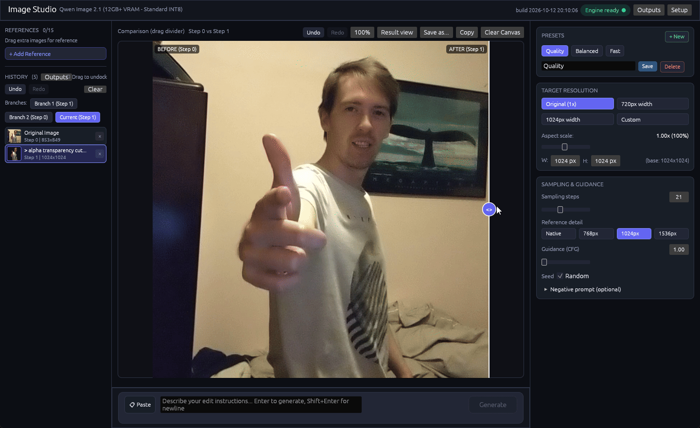
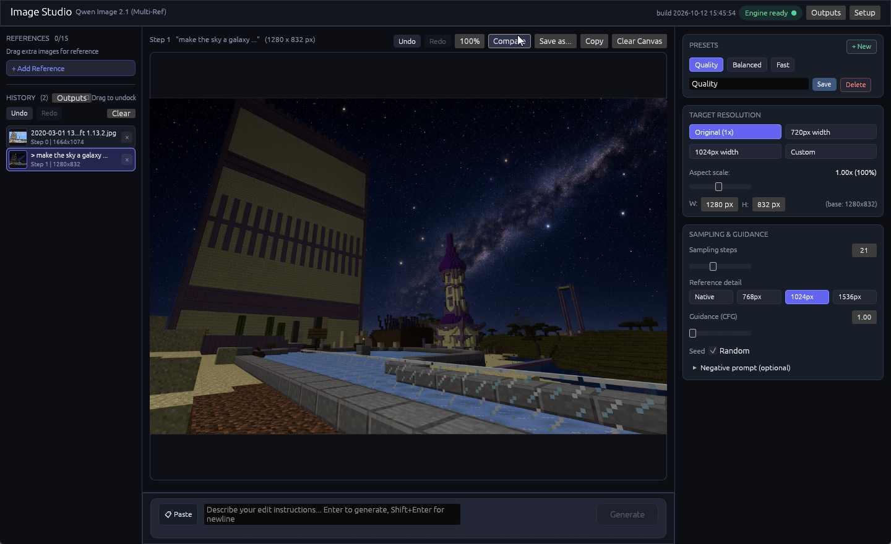
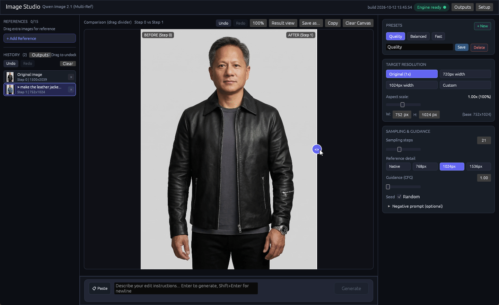

# Image Studio

## One-Click AI Image Editing on your GPU

Fast, native desktop app for image editing using open-weights diffusion models (Qwen Image 2.1 Multi-Ref) powered by ComfyUI running in the background.


### Alpha Transparency & Background Cutouts
"Alpha transparency cut-out of the guy in the picture"



### Generative Inpainting & Scene Alteration
"Make the sky a galaxy with bright stars"



### Material & Style Transfer
"Make the leather jacket a jeans jacket"



### Video Studio (Text-to-Video, Image-to-Video & Video Editing)
Cinematic AI video generation and editing powered by **MiniMax H3** (with native stereo audio, Reference-to-Video, and video editing) and **Lightricks LTX-Video 2.5 / 2.3** (2-stage distilled generation, spatial upscaling, and IC-LoRA video editing), paired with an integrated native player, trim/compression pipeline, and LoRA browser.

## Features

- **Pure Native Rust UI**: Built with `egui` / `eframe` - zero WebView, zero Chromium, zero web frameworks. Instant startup and responsive native performance.
- **Video Studio (MiniMax H3 & LTX-Video 2.5 / 2.3)**: High-fidelity text-to-video, image-to-video, first/last-frame continuation, Reference-to-Video (R2V), and video-to-video editing with native audio synthesis and optional Gemma 3 12B cinematic prompt enhancer.
- **Curated LoRA Browser & Manager**: Browse, download, manage, and apply curated LoRAs for Qwen Image, MiniMax H3, and LTX-2.5/2.3 (including Viggle Remake, IC-LoRA video editing, and turbo LoRAs) with inline prompt tag helpers.
- **Native Video Player, Trimmer & Multi-Shot History**: Custom video player using OpenH264 decoding and Rodio audio playback rendered directly into egui textures with scrubbing, playback speed, looping, trim/compression export, and instant frame extraction to branch the next shot.
- **Background Engine Supervisor**: Automatically detects, bootstraps, and supervises ComfyUI in the background without terminal clutter.
- **Model Manifest & On-Demand Downloader**: Verifies required model weights on startup (`models.json`) and downloads missing weights, quant variants, and LoRAs from Hugging Face with live progress, pause/resume, and Recycle Bin cleanup.
- **Hardware-Aware Quantization**: Auto-detects available VRAM to pick optimal GGUF/INT8 quants (including Unsloth Dynamic `UD-Q3_K_XL` / `UD-Q4_K_XL` / `UD-Q5_K_XL` and `UD-Q2_K_XL`) and W4A8 text encoders to prevent CUDA Out-Of-Memory errors.
- **Safe Process Lifecycle**: Uses Windows Job Objects (`JOB_OBJECT_LIMIT_KILL_ON_JOB_CLOSE`) to guarantee that all ComfyUI and Python subprocesses terminate immediately when Image Studio closes or crashes.
- **Branching History Tree**: Non-destructive editing with branching undo/redo history. Jump back to any previous step, diverge into a new branch without losing existing work, or switch between revision threads.
- **Split Comparison & Centered Canvas**: Pan and zoom inspection canvas with an interactive A/B comparison slider.
- **Presets & Speed Optimization**: Quick presets (Fast, Balanced, Quality) with configurable resolutions, steps, samplers, schedulers, and live execution warnings.

## Running

Download the latest standalone executable from [Releases](https://github.com/DeSinc/Image-Studio/releases) or launch from terminal:

```powershell
.\ImageStudio.exe
```

## Building from Source

Requires Rust 1.85+:

```powershell
cargo build --release
```

## License & Third-Party Engines

This project is licensed under the [MIT License](LICENSE).

Image Studio is an independent desktop application that communicates with local AI engines (such as ComfyUI) strictly as an external client via standard local IPC/APIs. No third-party execution engines, Python packages, or model weights are bundled or redistributed within this software. Users run local engines and retrieve open-weights models independently on their own hardware.
