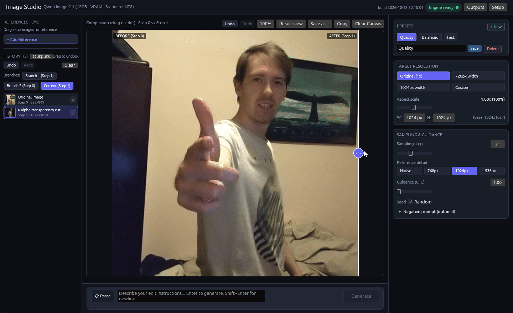
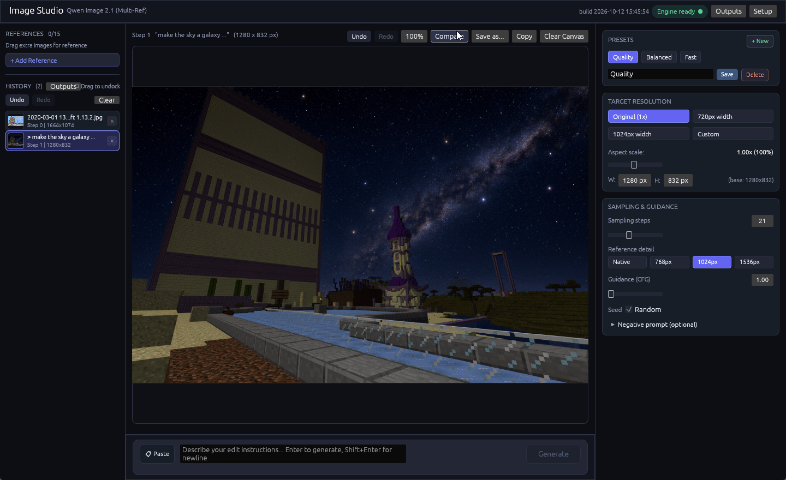
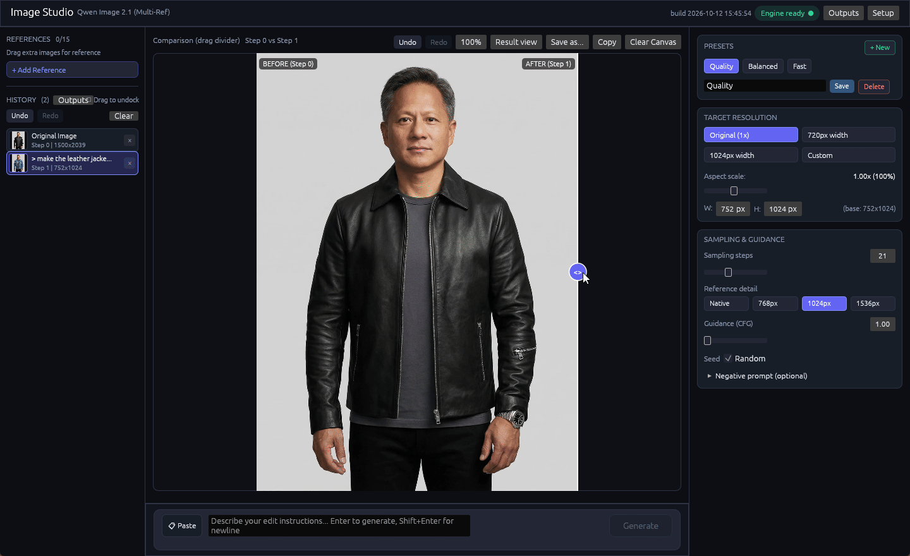

# Image Studio

## One-Click AI Image Editing on your GPU

Fast, native desktop app for image editing using open-weights diffusion models (Qwen Image 2.1 Multi-Ref) powered by ComfyUI running in the background.


### Alpha Transparency & Background Cutouts
"Alpha transparency cut-out of the guy in the picture"



### Generative Inpainting & Scene Alteration
"Make the sky a galaxy with bright stars"



### Material & Style Transfer
"Make the leather jacket a jeans jacket"



## Features

- **Pure Native Rust UI**: Built with `egui` / `eframe` - zero WebView, zero Chromium, zero web frameworks. Instant startup and responsive native performance.
- **Background Engine Supervisor**: Automatically detects, bootstraps, and supervises ComfyUI in the background without terminal clutter.
- **Model Manifest & On-Demand Downloader**: Verifies required model weights on startup (`models.json`) and downloads missing weights from Hugging Face with live progress.
- **Hardware-Aware Quantization**: Auto-detects available VRAM to choose between standard INT8 (12GB+ GPUs) and 4-bit W4A8 quantized text encoders (8GB GPUs) to prevent CUDA Out-Of-Memory errors.
- **Safe Process Lifecycle**: Uses Windows Job Objects (`JOB_OBJECT_LIMIT_KILL_ON_JOB_CLOSE`) to guarantee that all ComfyUI and Python subprocesses terminate immediately when Image Studio closes or crashes.
- **Branching History Tree**: Non-destructive editing with branching undo/redo history. Jump back to any previous step, diverge into a new branch without losing existing work, or switch between revision threads.
- **Split Comparison & Centered Canvas**: Pan and zoom inspection canvas with an interactive A/B comparison slider.
- **Presets & Speed Optimization**: Quick presets (Fast, Balanced, Quality) with configurable resolutions, steps, samplers, schedulers, and live execution warnings.

## Running

Download the latest standalone executable from [Releases](https://github.com/DeSinc/Image-Studio/releases) or launch from terminal:

```powershell
.\ImageStudio.exe
```

## Building from Source

Requires Rust 1.85+:

```powershell
cargo build --release
```

## License & Third-Party Engines

This project is licensed under the [MIT License](LICENSE).

Image Studio is an independent desktop application that communicates with local AI engines (such as ComfyUI) strictly as an external client via standard local IPC/APIs. No third-party execution engines, Python packages, or model weights are bundled or redistributed within this software. Users run local engines and retrieve open-weights models independently on their own hardware.
